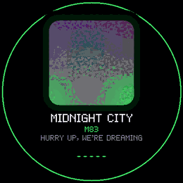
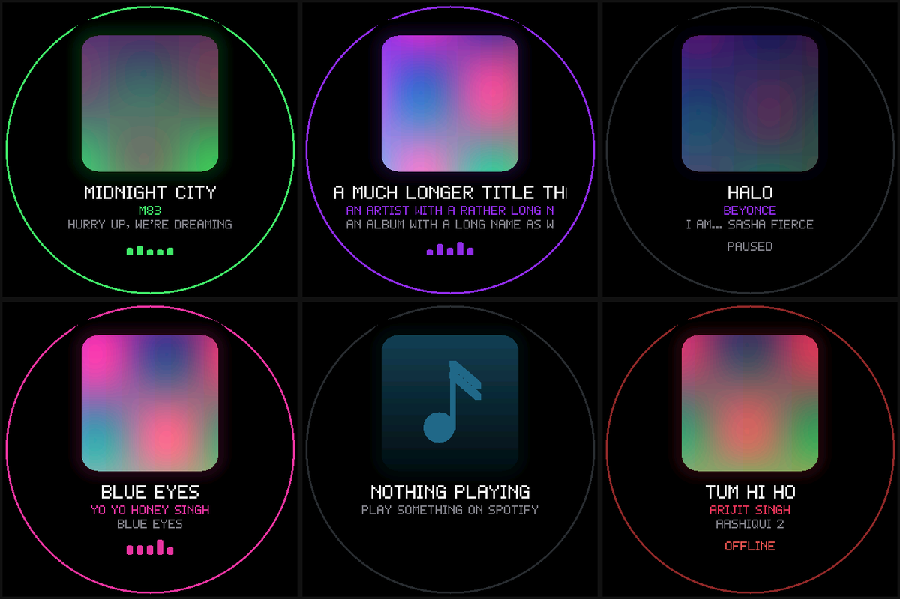
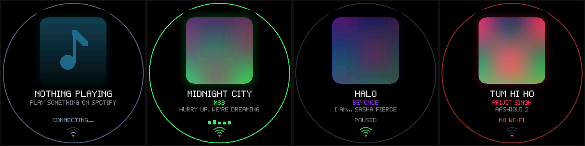

# cassette-orb

A round now-playing display. It shows the cover of whatever is playing on Spotify, with the title, artist and album scrolling underneath and a small equalizer while it plays. Runs on the Waveshare ESP32-S3-Touch-AMOLED-1.75C, powered by a battery or USB, no laptop needed.

The shots above come from the simulator, which runs the same renderer as the board. Top row: playing, a long title, paused. Bottom row: another song, nothing playing, offline.

## How it works

- The board joins Wi-Fi (WPA2-Enterprise PEAP works, so campus networks are fine) and polls a JSON endpoint every 4 s while playing, every 8 s otherwise.
- The endpoint is the now-playing route of my [portfolio](https://xevrion.dev/api/now-playing). Any URL that returns the same fields works, see `core/nowplaying.cpp`.
- The cover is fetched at 300 px, decoded, and averaged down to 216 px. A tint is picked from it for the ring, the halo, the artist line and the equalizer.
- Drawing is plain C++ into an RGB565 buffer. After the first paint only the scrolling lines and the equalizer are redrawn, and a paused player redraws nothing at all, so the panel sits idle.

On the board: about 2.5 ms of drawing per frame, internal heap steady near 190 KB, no display errors over a long run.

## Controls and status

- Tap wakes a dimmed screen. It dims after 90 s with nothing playing.
- Long press asks the site again right away, and the screen flashes up once.
- The Wi-Fi icon under the footer: green is joined and reaching the site, amber is joined but the site is not answering (`NO INTERNET`), one arc is still joining, a red dot is no network (`NO WI-FI`).
- If polls keep failing while the board thinks it is joined, it drops the link and rejoins, at most once every 30 s. Campus access points can end a session without telling the client.

## Layout

| Path | What |
|---|---|
| `core/` | Parsing, state and drawing. No ESP-IDF in here, it builds on a laptop. |
| `host/` | Tests and the SDL2 simulator. |
| `main/` | Wi-Fi, time sync, polling, cover decoding, the frame loop. |
| `roundkit/` | Shared board code, a [submodule](https://github.com/xevrion/roundkit). |

## Try it without the board

    git clone --recursive https://github.com/xevrion/cassette-orb
    cd cassette-orb
    make test                 # parser, state and renderer checks
    make sim                  # a window with fake songs
    ./host/build/sim --live   # a window showing what the endpoint says is playing now

Needs `g++` and SDL2. `--live` also needs `curl` and ImageMagick.

## Build for the board

Only Docker is needed on the host.

    cp main/secrets.example.h main/secrets.h    # fill in SSID, login, password
    make build
    make flash PORT=/dev/ttyACM0

`main/secrets.h` is git-ignored. The password ends up in the firmware you flash and nowhere else.

Debug options, passed to the build as `-D`:

| Option | Effect |
|---|---|
| `CASSETTE_URL=http://host:8000/now-playing.json` | Poll a local test server instead of the site. |
| `CASSETTE_DEMO=1` | Cycle fake songs, no network. |
| `CASSETTE_TRACE=1` | Log every poll. |

CMake caches these. Pass `=0` to switch one off again.

## License

MIT
